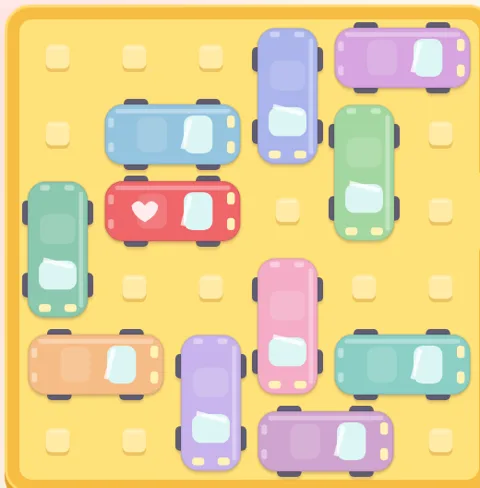
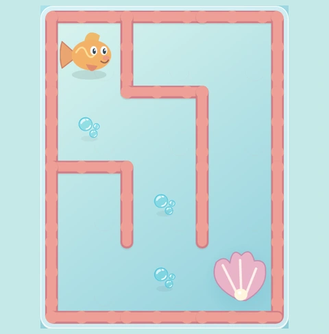

# Маленькие игры 🎮

Простые игры в браузере: один HTML-файл на игру, ничего устанавливать не нужно. Работают на телефоне, планшете и компьютере.

https://games.distantec.app/

## Игры

| | Игра | Играть | Репозиторий | Возраст |
| --- | --- | --- | --- | --- |
|  | Час пик | https://games.distantec.app/red-car/ | https://github.com/distantec-assistant/red-car | от 4 лет |
|  | Лабиринты, 60 уровней | https://games.distantec.app/maze/ | папка `maze/` в этом репозитории | от 3 лет |

## Час пик

### Цель

Выведите красную машинку с парковки 6×6 через выход справа. Для этого сдвигайте машинки и грузовики. Каждая фигура едет только вдоль своего направления, без поворотов.

### Управление

Тяните фигуру пальцем или мышью.

- ↶ — отменить ход
- ⟳ — начать уровень заново
- 💡 — подсказка. Кнопка открывается через 60 секунд после старта уровня, на ней идёт обратный отсчёт
- ♪ — включить или выключить звук
- кнопка выбора уровня

### Уровни

243 уровня по возрастанию сложности: кратчайшее решение — от 3 до 50 ходов. Набор фигур как в настольной игре в духе Rush Hour: до 12 машинок, включая красную, и 4 грузовика. Уровни с карточек оригинала показывают номер карточки под полем. Все уровни проверены решателем и имеют решение.

### Звёзды

- 3★ — ходов не больше, чем минимум × 1,2, округлённый вверх
- 2★ — ходов не больше, чем минимум × 2
- иначе 1★
- подсказка оставляет 1★
- сохраняется лучший результат
- отмена хода уменьшает число ходов

### Между уровнями

Около 3 секунд красная машинка едет по дороге, на которой написан номер следующего уровня. Нажмите, чтобы пропустить. Этот экран не показывается, если уровень выбран из списка или начат заново.

### Выход в каталог

Внизу маленькая ссылка «← Все игры». Она срабатывает, если удерживать её около секунды (чтобы не нажать случайно) или нажать Enter.

### Звуки

Короткие звуки машинок, без музыки. Звук можно выключить.

### Прогресс

Прогресс хранится в браузере (`localStorage`) на этом устройстве. Если очистить данные сайта, прогресс сбросится.

## Лабиринты

Проведите героя по дорожке к цели.

12 миров, они не повторяются подряд: зайчик → морковка, пчёлка, машинка → гараж, рыбка → ракушка, ракета → планета, щенок, мышка → сыр, пингвинёнок → иглу, медвежонок → мёд, утёнок, принцесса → замок, динозаврик → яйцо.

Игра открывается на главном экране: большая кнопка «Играть» и сетка уровней. Кнопка-домик в игре возвращает на этот экран. Герои двигаются плавно.

60 уровней, поля от 3×3 до 9×14. Управление пальцем, свайпами или стрелками. На пути есть призы. Подсказка открывается через 60 секунд. Ссылка «← Все игры» срабатывает, если удерживать её 1 секунду. Прогресс хранится в браузере (`localStorage`).

## Для родителей

- На телефоне игру можно добавить на домашний экран.
- Без рекламы и без регистрации.
- Данные никуда не отправляются.

## Как устроен сайт

Каталог публикуется через GitHub Pages. Этот репозиторий — корень сайта, в `CNAME` указан домен `games.distantec.app`.

Игра может быть отдельным репозиторием («Час пик» открывается по пути `/red-car/`) или папкой здесь («Лабиринты» лежат в `maze/` и открываются по пути `/maze/`).

Чтобы добавить игру:

1. Создайте репозиторий с `index.html`.
2. Включите GitHub Pages.
3. Добавьте карточку в `index.html` этого каталога.
